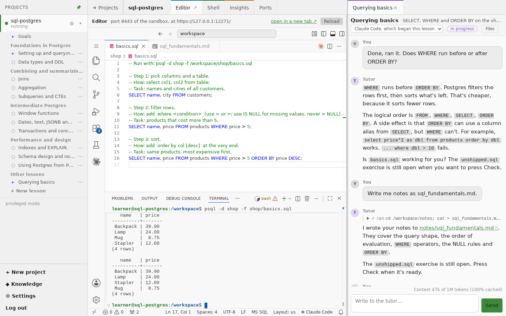
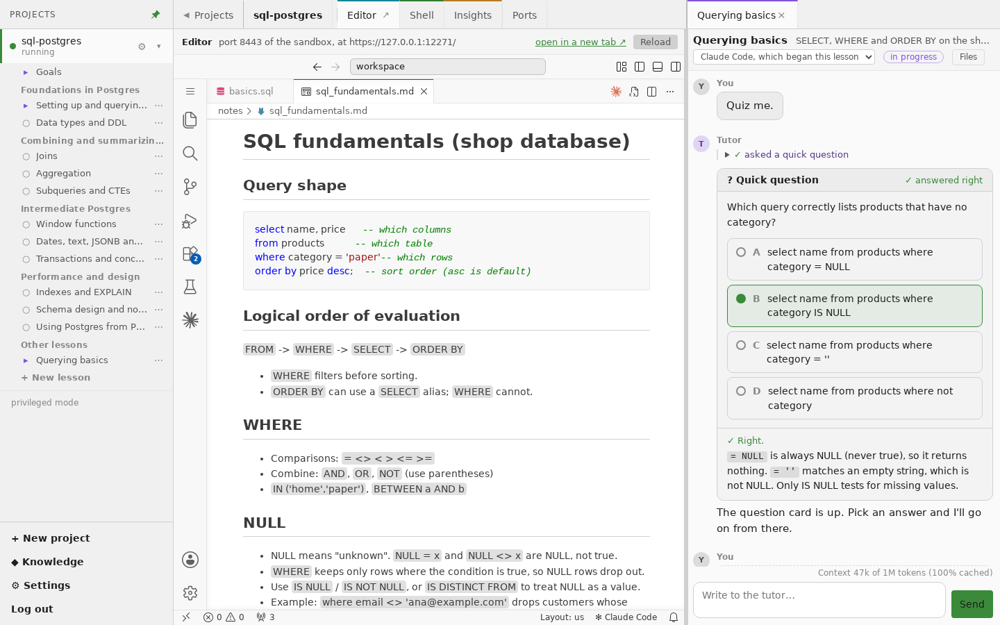
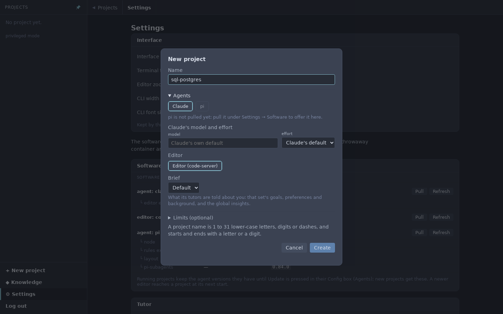
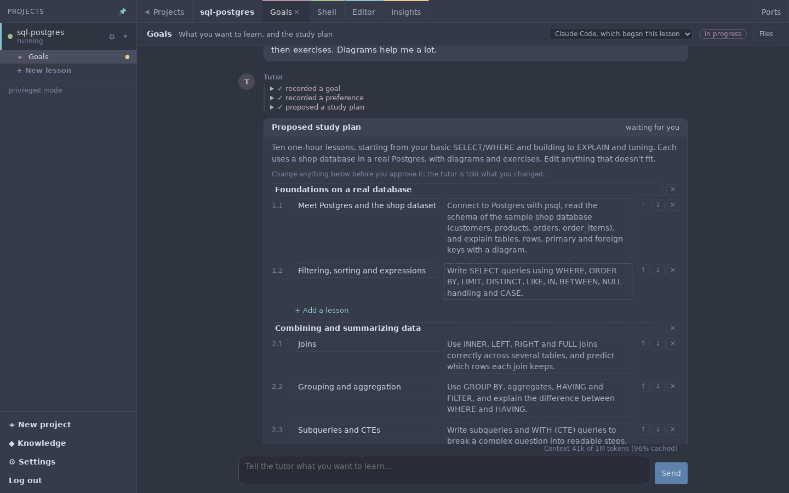
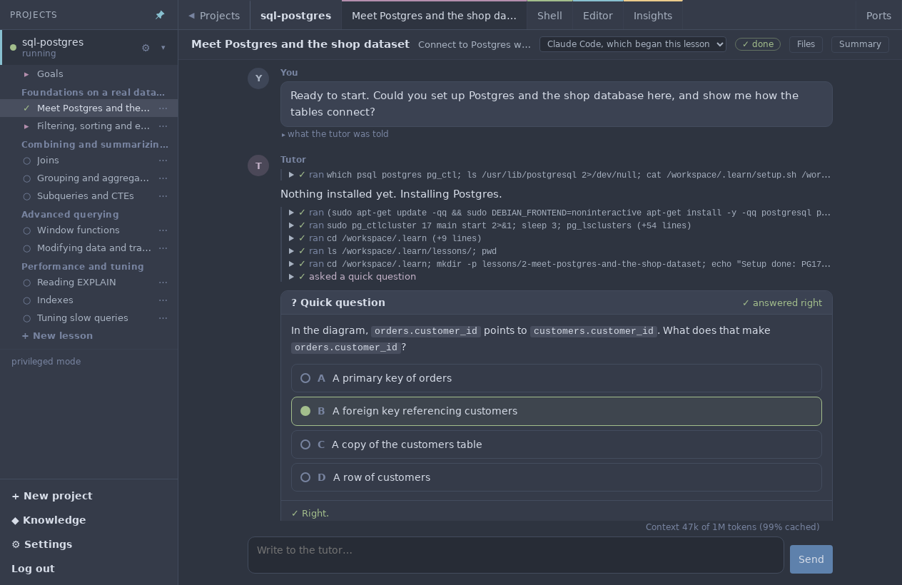
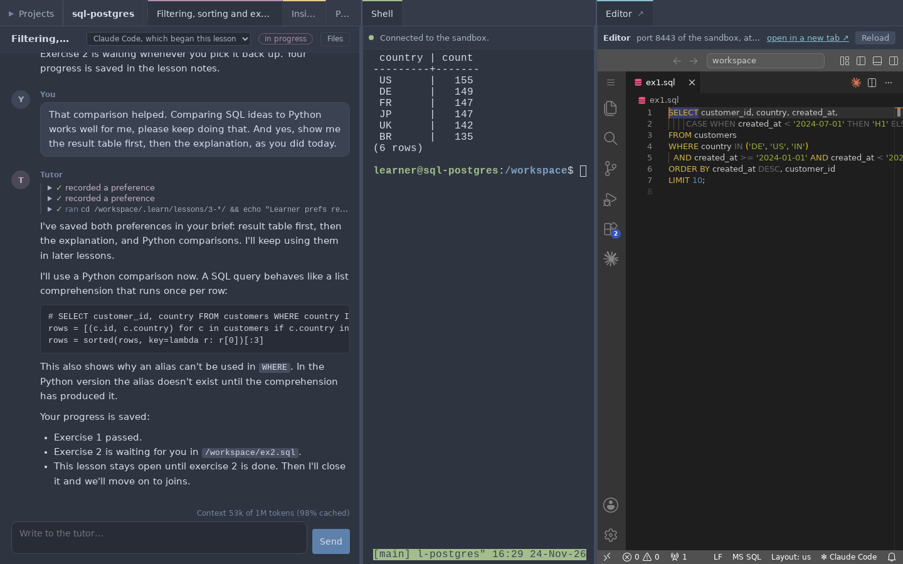

<div align="center">


<h3>clanker-learn</h3>

A tutor you run on your own machine.<br>
Learn a technical subject by doing it in a real Linux sandbox, with a tutor that works beside you and remembers what you know.


[Getting started](docs/guide/getting-started.md) · [Lessons](docs/guide/lessons.md) · [Knowledge](docs/guide/knowledge.md) · [Agents](docs/guide/agents.md) · [Security](docs/guide/security.md) · [FAQ](docs/guide/faq.md)

</div>

<picture>
  <source media="(prefers-color-scheme: dark)" srcset="docs/assets/teach-1-dark.png">
  
</picture>

<picture>
  <source media="(prefers-color-scheme: dark)" srcset="docs/assets/teach-2-dark.png">
  
</picture>

## What it does

- **A sandbox per subject.** Each project is its own Linux container with a code editor and a terminal. You and the tutor install and run whatever the subject needs.
- **A study plan.** Tell the tutor what you want to learn and what you know; it proposes small lessons, and you edit and approve the plan.
- **Hands-on lessons.** The tutor sets up real code, databases and servers, explains with diagrams and tables, and checks your work with exercises and quick questions.
- **It remembers you.** Your goals, how you like to be taught and the lessons you finished carry over to every project. You can see and edit all of it.
- **Runs on your machine.** One container, with your own Claude subscription (Claude Code) or any provider pi supports.

## Install

You need:

- Linux with [Docker](https://docs.docker.com/get-docker/) and Docker Compose. [Sysbox](https://github.com/nestybox/sysbox) is recommended; without it, `./setup` uses privileged mode.
- A Claude subscription, or an account with a provider pi supports.

```bash
git clone https://github.com/joaopn/clanker-learn.git
cd clanker-learn
./setup
docker compose up -d
```

Open https://127.0.0.1:7788, accept the certificate, and enter the set-up code from `docker compose logs` to choose a password.

<details>
<summary>Update</summary>

Make a backup in Settings → Backup, then:

```bash
git pull
docker compose up -d
```

Your projects, conversations and settings are kept.

</details>

Settings, backups and uninstalling: [Getting started](docs/guide/getting-started.md).

## How it works

**1\.** Make a project for a subject.



**2\.** Tell the tutor what you want to learn. Edit the study plan it proposes and approve it.



**3\.** Open a lesson. The tutor sets things up in the sandbox, explains, and tests you with exercises and quick questions.



**4\.** Work in the same sandbox, with the Shell and the Editor beside the conversation.



**5\.** See and edit what the tutors know about you on the Knowledge page.


More in the [docs](docs/).

## Built from

Built on [research-sandbox](https://github.com/joaopn/research-sandbox) and [gaggiclanker](https://github.com/joaopn/gaggiclanker). Personal project by [joaopn](https://joaopn.github.io/).

## License

GNU AGPL v3, see [LICENSE](LICENSE). Contributions welcome: [CONTRIBUTING.md](CONTRIBUTING.md).
