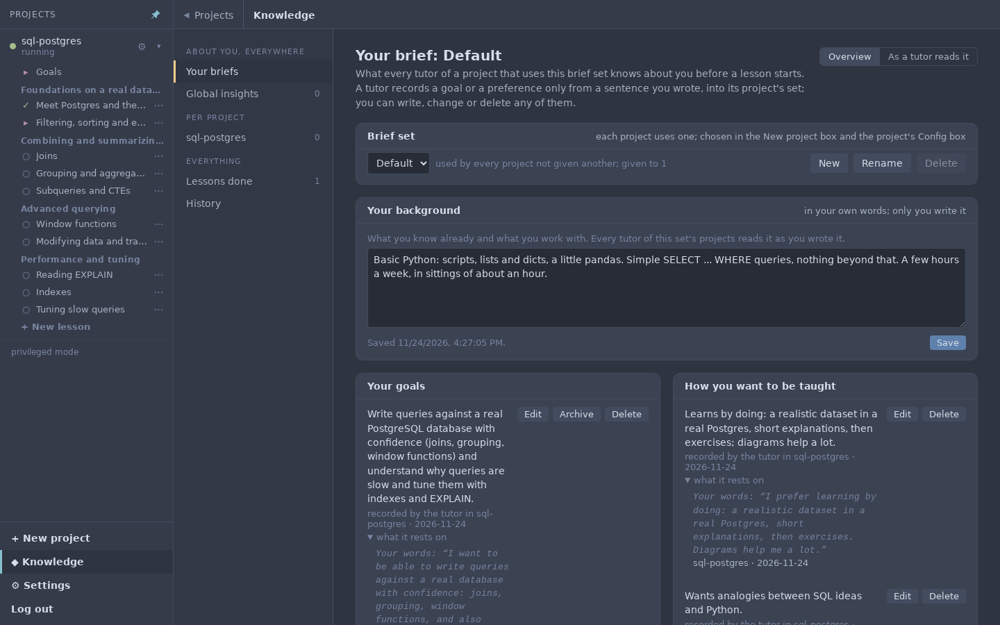

<div align="center">


<h3>clanker-learn</h3>

A tutor you run on your own machine.<br>
Learn a technical subject by doing it in a real Linux sandbox, with a tutor that works beside you and remembers what you know.


[Getting started](docs/guide/getting-started.md) · [Lessons](docs/guide/lessons.md) · [Knowledge](docs/guide/knowledge.md) · [Agents](docs/guide/agents.md) · [Security](docs/guide/security.md) · [FAQ](docs/guide/faq.md)

</div>

<picture>
  <source media="(prefers-color-scheme: dark)" srcset="docs/assets/hero-dark.png">
  
</picture>

## What it does

- **A sandbox per subject.** Each project is a Linux container of its own, with a workspace, a terminal and a code editor, where you and the tutor install and run whatever the subject needs.
- **A study plan from a conversation.** The tutor asks what you want to be able to do, what you know and how much time you have, then proposes modules of small lessons. You edit the plan and approve it.
- **Lessons where the tutor builds and runs real things.** It sets up databases, servers and code in the sandbox, shows diagrams, tables and plots, and sets exercises it checks and quick questions.
- **A brief of what you know.** The tutors keep your goals and how you want to be taught, in your own words, the lessons you finished and notes on how you learn; you read, edit and delete all of it on the Knowledge page.
- **Local.** One container on your machine, driven by your own Claude subscription (Claude Code) or a provider of your choice (pi). clanker-learn itself sends no telemetry.

## Install

You need:

- Linux with [Docker](https://docs.docker.com/get-docker/) and Docker Compose. [Sysbox](https://github.com/nestybox/sysbox) is recommended; where it is not installed, `./setup` falls back to privileged mode, which makes the container root-equivalent on your machine.
- A Claude subscription for Claude Code, or a provider pi supports.

Only x86-64 has been run so far, and pi has not yet answered through a real model (it was run against a stand-in).

```bash
git clone https://github.com/joaopn/clanker-learn.git
cd clanker-learn
./setup
docker compose up -d
```

Open https://127.0.0.1:7788, accept its self-signed certificate, and type the set-up code that `docker compose logs` shows to choose your password.

<details>
<summary>Update</summary>

Make a backup first (Settings → Backup), then, in your copy of the repository:

```bash
git pull
docker compose up -d
```

The image is built again and the container made again from it; your projects, conversations and settings stay on their volumes.

</details>

Settings, backups and uninstalling: [Getting started](docs/guide/getting-started.md).

## How it works

**1\.** Make a project for a subject: a name, the agents it gets, and the editor.


**2\.** In Goals, tell the tutor what you want to learn. It proposes a study plan as a card; change what does not fit and approve it, and the lessons appear in the sidebar.


**3\.** Open a lesson. The tutor sets things up in the sandbox (each command it runs is a line you can open), explains with diagrams and tables, and asks quick questions and sets exercises.


**4\.** Work in the same sandbox: drag the Shell and the Editor beside the conversation.


**5\.** The Knowledge page shows what every tutor is told about you: your background, your goals and preferences with the words they rest on, and the lessons you finished.



More in the [docs](docs/).

## Built from

The sandboxes, the web interface and the broker come from [research-sandbox](https://github.com/joaopn/research-sandbox); the knowledge base and the conversation's server side from [gaggiclanker](https://github.com/joaopn/gaggiclanker). It is a personal project shared in case it is useful: no roadmap or support commitment.

## License

GNU AGPL v3, see [LICENSE](LICENSE). Contributions welcome: [CONTRIBUTING.md](CONTRIBUTING.md).
