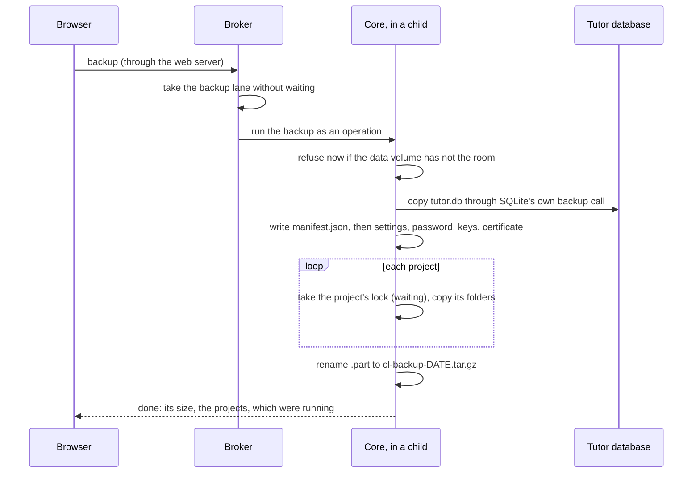
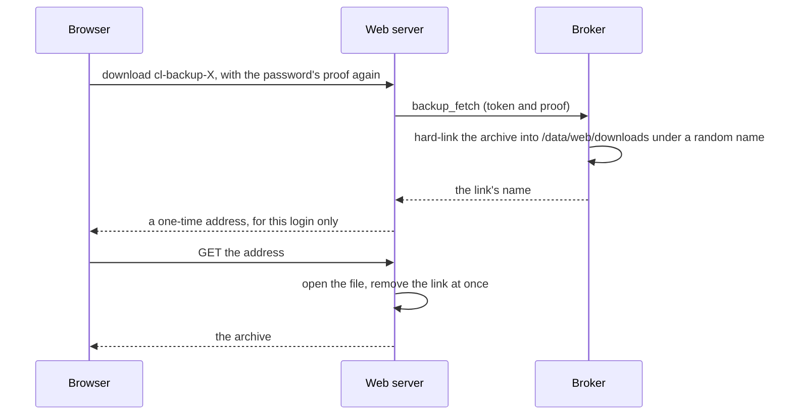
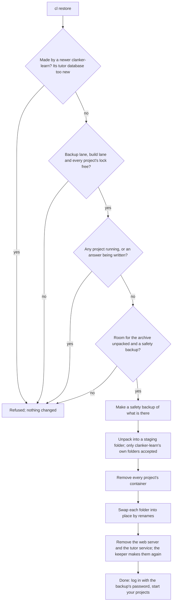

# Backups

A backup is one archive holding everything clanker-learn keeps for you: every project's workspace and home folder, the tutor's conversations, plans and knowledge, your settings, the password and the keys. It is made from Settings → Backup or with `cl backup`, while your projects keep running. A restore puts one back in place of everything there is, also onto a new installation; it is the `cl restore` command only, with every project stopped.

Using it: [Backups](../guide/backups.md)

## How it works

### Making one

The archive is a gzipped tar in `/data/backups`, named `cl-backup-<UTC time>.tar.gz`, written under a temporary name and renamed when whole. Its first member is `manifest.json`: the format and its version, when and by which image it was made, the tutor database's version, the projects and which of them were running, and what is not inside. The tutor's database is copied through SQLite's backup call, so a running tutor service does not tear it; everything else is copied as it stands. A project that runs while it is copied may be caught mid-write, and the result says which projects were running and how many files changed or vanished while they were read.

| In it (under `/data`) | Not in it |
|---|---|
| `projects/`, `homes/`: every workspace and home folder, with each project's agents and logins | `dist/`: the fetched software, fetched again at the first start or with Pull |
| `tutor/`: conversations, plans, knowledge, the Claude token, the keys the tutor logs in with | what was installed in a sandbox outside its workspace and home: the project's setup recipe brings it back |
| `core/`: project records, keys, Shell passwords, ports named by hand, the shared secret | `backups/`: the backups themselves |
| `web/`: the page's certificate and the web server's tables | what a software build left half made |
| `broker/`: the password's hash and the audit log | |
| `versions.local.env`: versions raised by Refresh | |

### Downloading and removing one

The link is in the web server's own folder on the same volume, so nothing is copied; one the web server never took is cleared after ten minutes. Removing a backup asks for the password again too.

### Restoring

`cl restore <name or path>` in the outer container (`docker exec clanker-learn cl restore ...`). For a new installation the archive is first copied into the container; the backups folder exists from the first start.

After a restore, each project's container is made again at its next start from its restored record, and its setup recipe runs once. The web server and the tutor service come back within seconds and read the restored state; the sessions of the old password are gone.

## Design decisions

### A restore is a command, not a button

It replaces everything and wants every project stopped, so it is not something a browser left logged in should be able to do. The broker has no verb for it.

### What is there is kept first

Before anything is replaced, a backup of the current state is made (marked as made before a restore), so a restore of the wrong archive can itself be undone.

### A backup holds your keys

The password's hash, the Claude token, the keys into every sandbox, your agents' logins. Keep it as safely as those. It is not encrypted.

### The web server never sees the backups folder

It would read every backup, and each one holds the keys above. A download hands it one archive at a time, after the password was given again, at an address that works once and only for the login that asked.

### Not enough room is refused before anything is written

A backup or a restore says how much is free and how much it needs. The check for a backup is cautious: it counts your files at their full size, though the archive comes out smaller.

### A backup from a newer clanker-learn is refused

A tutor database of a newer version would be half understood, so the restore stops and says which version it needs. An older one is brought up to date in place when the tutor service next starts.

### One backup or restore at a time

They share a lane of their own. A backup does not hold the build lane, since the distributions are not in it; a restore does, since it must not run beside a build.

### Left out for now

A schedule, and encryption.

## Where it lives

| Path | What |
|---|---|
| `outer/core.py` | `write_backup`, `backup_fetch`, `backup_rm`, `restore`: the archive, the manifest, the room checks, the safety backup, the swap |
| `outer/broker.py` | The `backup`, `backup_list`, `backup_rm` and `backup_fetch` verbs and the backup lane |
| `web/server.py` | The backup routes and the one-time download |
| `tutor/store.py` | The tutor database's version, which a restore checks |
