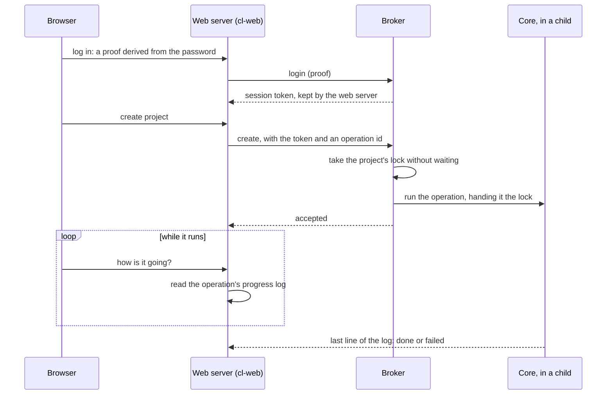

# Broker

The broker is the one door through which anything that touches projects is asked for. It is a process of the outer container, started by the init once the container is ready, listening on a Unix socket that no sandbox has. The web server is its only client; it holds no Docker socket and no project folder, so every create, start, stop, backup or build it shows you is a request to the broker, which checks your login and the request and has the core do the work. Its protocol and its login are research-sandbox's, kept so that research-sandbox's web server fits with few changes.

Using it: [Getting started](../guide/getting-started.md), [Security](../guide/security.md)

## How it works

### The wire

One request per connection, on `/run/cl/broker/broker.sock`: a four-byte length, then a JSON object `{"verb", "args", "token"?, "op_id"?}`; the answer is framed the same way, `{"ok": true, "result": ...}` or `{"ok": false, "error": {"kind", "message"}}`. The socket is mode 0600 and the connecting process must be the broker's own user. A request over 64 KiB is refused before its body is read, and one that has not arrived whole within five seconds is dropped. The web server's container gets the socket's folder read-only.

### What it knows how to do

The verbs are a closed table. A verb not in it is unknown, and each verb takes only its own fields; there is no pass-through to the inner Docker daemon.

| Verbs | What they do | Needs |
|---|---|---|
| `list`, `status`, `op` | the projects, one project's state, how an operation stands | nothing (the web server asks for a login anyway) |
| `setup_needed`, `first_password` | whether a first password can be set, and setting it with the set-up code | the set-up code |
| `login`, `logout` | a session token from the password's proof, and ending it | the proof |
| `create`, `start`, `stop`, `recreate` | the project's lifecycle, as an operation | a token |
| `destroy` | removes a project, as an operation | a token and the password again |
| `limits` | the project's limits, answered at once | a token |
| `attach` | where and how the Shell logs in to a running sandbox (address, user, Shell password, host-key fingerprint) | a token; audited |
| `port_detect`, `port_list`, `port_add`, `port_remove` | what listens in a sandbox, and the ports named by hand | a token |
| `software_status`, `models`, `agent_refresh_check`, `editor_refresh_check`, `pin_reset` | what is fetched of each piece of software, the model catalogue, asking the makers for the newest version, going back to the shipped version | a token |
| `agent_pull`, `agent_refresh`, `editor_pull`, `editor_refresh` | fetching software, as an operation of no project | a token |
| `agents_add`, `agents_update` | an agent added to, or updated in, a running project, as an operation | a token |
| `agents_model` | an agent's model and effort in a running project, answered at once | a token |
| `backup`, `backup_list`, `backup_active` | making a backup (an operation of no project) and listing them | a token |
| `backup_rm`, `backup_fetch` | removing a backup, and linking one into the web server's folder for one download | a token and the password again |
| `mode` | whether clanker-learn runs on sysbox or privileged | a token |
| `lifecycle_active`, `build_active`, `build_alive` | the operations in flight | a token |

Logins, the first password, every verb that changes something, and `attach`, are written to the audit log (`/data/broker/audit.log`) with its outcome; the password, its proof and the set-up code never reach a log.

The gates come in a fixed order: a changed password's end of sessions, the auth verbs, an unknown verb, the arguments, the set-up verbs, the token, the step-up (the password again), the verb's own fields, then the verb's own checks. A caller without a token learns nothing beyond the three open reads and whether a first password can be set.

### Operations

The verbs that can take long (`create`, `start`, `stop`, `recreate`, `destroy`, `agents_add`, `agents_update`, the four builds and `backup`) run as operations. The broker answers at once; the work runs in a child, a fresh interpreter given only the verb, the checked name and choices, and the caller's operation id, which calls the core and writes a progress log beside the socket (`oplogs/<op_id>.view.log`, one JSON line per step, the last `done` or `failed`). The web server reads that log to show you the progress.

| Lane | What it holds | A second request while one runs |
|---|---|---|
| A project's lock | one operation on that project | refused as busy, at once; other projects go on |
| The build lane | one software build, whatever it builds | refused, saying what is being built |
| The backup lane | one backup or restore | refused |

What says an operation runs is the core's own lock: the broker takes it without waiting and hands the held lock to the child. The kernel keeps it for as long as the child lives, across a restart of the broker, with no process id written anywhere. If the broker ends, the init starts it again within seconds and running operations go on.

### Logging in

The browser never sends the password. It derives a proof from it (PBKDF2-SHA256, 600,000 rounds, a fixed public salt) and sends that; the broker stores an scrypt hash of the proof, with a salt of its own, in `/data/broker/passwd.json`. A good proof gets a random session token that lives eight hours and is held only in the broker's memory: a restart of the broker ends every session, and so does a changed password. The web server keeps the token server-side, under a cookie (see [Web server](web-server.md)).

### The first password

At a start with no password set (and the web server on), the init makes a set-up code of twenty letters and digits, prints it once in the container's log, and hands it to each broker on its standard input; it is kept nowhere else. The page asks for it with the new password. The code never replaces a password that is set, and ten wrong codes within a minute shut that door for a minute. `cl passwd` sets or changes the password from a shell in the outer container instead.

## Design decisions

### A closed vocabulary, not a Docker socket

The web server faces the browser, so it is the part most worth taking over. It gets a list of things it may ask for, each checked by the broker, and nothing else: there is no verb that runs a command of the caller's choosing in a sandbox or reaches the inner daemon.

### The password never reaches clanker-learn

Only the proof crosses the wire, and only a hash of the proof is stored. A changed password ends every session.

### One operation per project, refused rather than queued

A second request for a busy project is refused at once, saying so, rather than queued behind an operation whose outcome might change what the second one means. Different projects work in parallel.

### Builds and backups have a lane of their own

A software build belongs to no project, so it holds the build lane instead of a project's lock; a backup holds the backup lane, and copies each project under that project's lock, waiting for an operation on it to end, so a create or a destroy is never cut through. A restore is not a verb at all: it replaces everything, so it is the `cl restore` command only (see [Backups](backups.md)).

### Operations outlive the broker

They run in children of their own, and their state is a lock and a log on disk, not the broker's memory, so a broker that ends and is started again finds them still running.

### Destroy, removing a backup and downloading one ask for the password again

These are the actions a browser left logged in should not be able to take alone: destroy cannot be undone, a backup may be the only copy of a destroyed project, and a backup holds the password's hash, the Claude token and every project's keys.

## Where it lives

| Path | What |
|---|---|
| `outer/broker.py` | The socket, the verb table, the gates, operations and their logs, the lanes |
| `outer/broker_auth.py` | The proof's derivation, the password file, sessions, the audit log |
| `outer/core.py` | What each verb does; the project locks and the build and backup lanes |
| `outer/init.py` | Starting the broker, restarting it, the set-up code |
