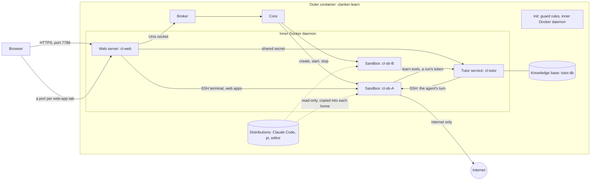

# How it works

This section explains how clanker-learn works inside: what runs where, what connects to what, what happens when you press something, and why it was built that way. Each page covers one part of the system. It describes the mechanism (diagrams, tables, the rules the code follows), then the design decisions behind it and the reasons for them, and ends with a table of where that part lives in the repository. To learn what to click, see the [User guide](../guide/index.md).

Everything runs in one container on your machine, the outer container. It holds a Docker daemon of its own, which runs one sandbox per learning project, the web server your browser talks to, and the tutor service that runs the lessons. Much of the design is lifted from two earlier projects by the same author: [research-sandbox](https://github.com/joaopn/research-sandbox) (the container, the broker, the web server, how agents and the editor reach a project) and [gaggiclanker](https://github.com/joaopn/gaggiclanker) (the store of answers, the stream to the browser, the rules of the knowledge base).

| Page | What it covers |
|---|---|
| [System overview](system.md) | The one container, its two modes (sysbox and privileged), what it does at every start, the guard rules that fence sandboxes, the inner containers, the ports, and where your data is kept. |
| [Sandboxes](sandboxes.md) | What a project is made of, the sandbox container and its limits, what a sandbox does at every start, the setup recipe and services, the `cl` command. |
| [Broker](broker.md) | The one door to anything that touches projects: its closed list of verbs, the login and the first password, operations and their progress, the build and backup lanes. |
| [Web server](web-server.md) | What the browser talks to: the login cookie, the relay to the broker and the tutor, terminals, web apps on ports of their own, raw TCP ports, the certificate. |
| [The page](the-page.md) | What you see in the browser: projects and lessons, the tabs and their columns, Settings, Knowledge, and the content-security rules the page lives under. |
| [The tutor](tutor.md) | Goals and the study plan, lessons as conversations, how a turn runs in the sandbox over SSH, the "learn" tools, the two agents and switching between them. |
| [Knowledge](knowledge.md) | What clanker-learn keeps about you across projects, who may write each part, brief sets, the brief every tutor reads, evidence, history and undo. |
| [Software](software.md) | Claude Code, pi and the editor: fetched into distributions by a throwaway container, copied into each project's home, updated from Settings. |
| [Backups](backups.md) | One archive of everything that is yours, what it holds and leaves out, the download, and the restore. |
