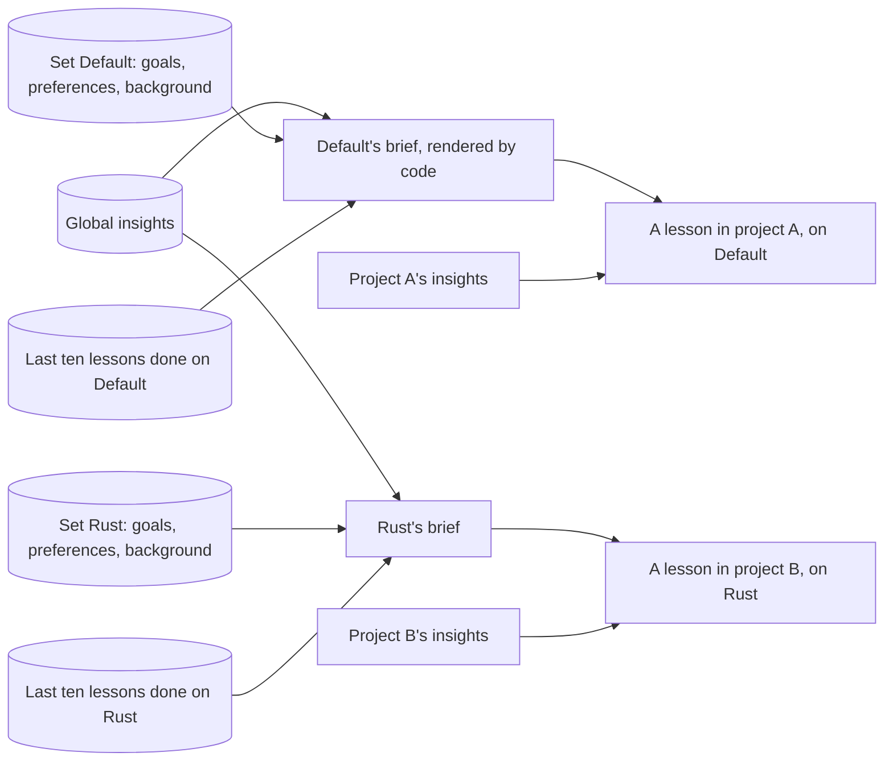
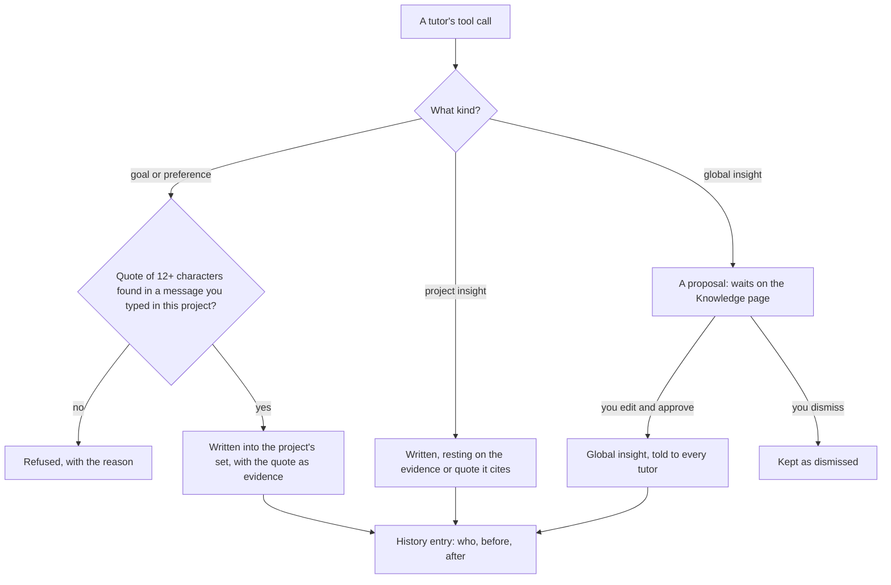

# Knowledge

clanker-learn keeps a view of you across your projects, so that the tutor of one subject knows what you did in another. It is small on purpose: your goals, how you want to be taught, your background in your own words, how you learn, and one line on each lesson you finished. Every part rests on something you said or did, every tutor is told only what it may be told, and all of it is yours to read, change and undo on the Knowledge page. It lives in the tutor service's database, beside the lessons.

Using it: [Knowledge](../guide/knowledge.md)

## How it works

### What is kept, who writes it, who is told

| What | Who writes it | Who is told |
|---|---|---|
| Your background, in your own words (one per brief set) | only you | the tutors of the projects on that set |
| Goals and preferences (in a brief set) | you; or a tutor, quoting a sentence you typed in that project (into that project's set) | the tutors of the projects on that set |
| Lessons done: a summary and one line each | the lesson's tutor, when it closes the lesson | a set's tutors get the last ten one lines of that set's projects; the rest are found by search |
| A project's insights: how you learn there (a misconception, a strength, what worked, what did not) | that project's tutors, resting on evidence or your words | that project's tutors only |
| Global insights: how you learn anywhere | proposed by a tutor and applied by you, or written by you | every tutor, whatever its set, once approved |
| Evidence: a check that ran, an answer you gave, a sentence you typed, a lesson closed | the system itself | shown to you under the record it supports |
| The history of every change, with before and after | the system | you; each entry can be undone |

There is no list of concepts with levels. What you know is read from the lessons you finished and from what you wrote about yourself.

### Brief sets

You can keep several brief sets (for work and a hobby, say, or for several people), and each project uses one. A set holds goals, preferences and a background; everything else (global insights, project insights, evidence, the history) belongs to the whole installation. A project's set is chosen in the New project box and changed in its gear; a project given none uses Default, which holds everything there was before sets existed. A set can be made empty or as a copy of another, renamed, or deleted once no project uses it.

### The brief

The brief is rendered from the records by code, not written by a model, so the same records always give the same text: the set's goals, preferences and background, the global insights, and the ten lessons done most recently in the projects on that set. It is never shortened, whatever its length. Every lesson starts with its set's brief and its own project's insights in its opening context; a tutor can ask for the current brief (`brief_get`) and search the rest (`records_search`). The Knowledge page shows a set's brief by its parts and exactly as a tutor reads it.

### How a tutor writes

A quote is compared with whitespace collapsed and case folded, and only against messages you typed: a line the system composed for you (the result of a Check, an answer chosen on a card) never counts. An insight is never edited in place: a tutor replaces it (the new one names the old) or retires it with a reason.

### What you see

- **Knowledge**, at the bottom of the project list, with a dot while a global insight waits for you.
- **Your briefs:** the set shown is picked on its card; its goals, preferences and background are edited there.
- **Goals archived:** a goal reached or dropped is archived rather than deleted. It leaves the brief and the search, so no tutor is told it any more, and stays on the card behind "show archived", with Restore. Archive and restore are in the history like any other change.
- **Proposals waiting:** the tutor's text to edit, what it rests on, similar insights from your other projects beside it (the proposing tutor never sees those), Approve and Dismiss.
- **Each project's insights**, also in the project's own Insights tab.
- **Lessons done**, every project's, with a search.
- **History:** who changed what, before and after, with Undo. An undo is refused when the record changed since.
- **In a lesson:** an exercise is a card with its steps and a Check button; the check is a command the tutor service runs in your sandbox, and the card shows what came back. A quick question is answered on its card; the right answer shows only after.

### When a project is destroyed

What you learned in it is kept, marked as from a removed project: its summaries, goals and preferences for the other tutors, its insights for you only. A box in the destroy dialog forgets it all instead.

## Design decisions

### A tutor cannot put words in your mouth

A goal or a preference from a tutor must quote a sentence you typed in that project. These are what every tutor on the set is told, so they rest on your words, never on a tutor's reading of you.

### A project's insights stay in the project

No tool and no brief gives them to another project's tutor. What crosses projects is what you approved, what you said, and the one line of each finished lesson, which tutors are asked to keep to what was covered: how you struggled belongs in an insight, which stays.

### Tutors propose global insights; you decide

A global insight is told to every tutor, so only you apply one, in your own edited words. There is no limit on how many.

### Global insights are not part of a set

How you learn holds everywhere; a set changes what you want and what you know.

### The brief is never cut

A long brief costs context in every lesson, which the line under the conversation shows, rather than losing lines silently.

### Summaries and your own background, not a ledger of concepts

A list of concepts with levels costs the tutor attention in every lesson, two tutors name the same thing differently, and a level looks more exact than it is.

### An answer or a Check is taken at once

Also while the tutor is writing; the tutor is told with your next message, or at once when it is not writing.

### Archived goals are told to no tutor, not even through search

The brief and the search say what holds now; the record of what you once aimed for is yours, on the Knowledge page.

### Everything is shown with what it rests on, and can be undone

Some things are not protected, and this is the answer to them: a check shows a state of the sandbox, not who brought it there; a question's answer is in the tutor's own files in your sandbox; what is in a sandbox can steer its tutor, and so what it records and proposes.

### Taken from gaggiclanker

The rules: a quote of your own words, insights that rest on what they cite and are replaced rather than edited, an owner's insights told only to that owner, and a general one only once a person confirmed it. New here: the history and undo, the rendered brief, brief sets, and the word overlap that finds similar insights.

## Where it lives

| Path | What |
|---|---|
| `tutor/knowledge.py` | Records, evidence, the quote rule, the brief, brief sets, proposals, history and undo, search, a removed project |
| `tutor/tools.py` | The tools a tutor writes and reads with |
| `tutor/cards.py` | Exercises and quick questions, whose results become evidence |
| `tutor/server.py` | The Knowledge page's routes |
| `tutor/schema.sql` | The tables |
| `web/static/app.js` | The Knowledge page and the Insights tab |
