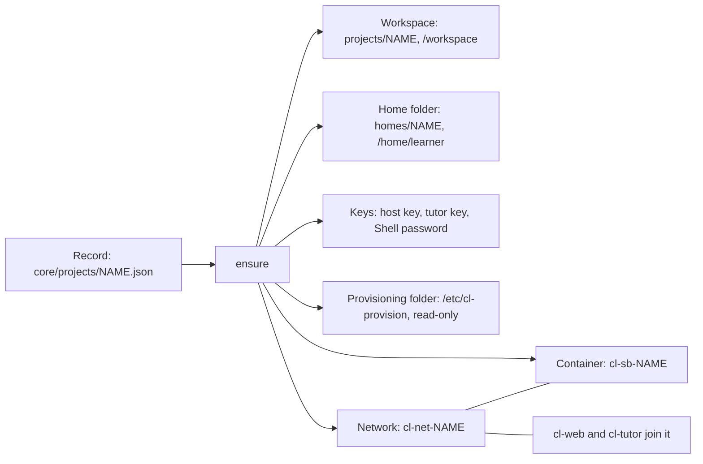
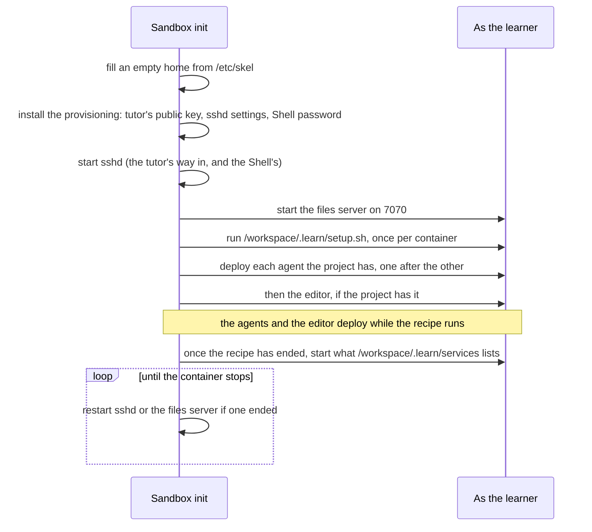

# Sandboxes

A project is one learning subject, and each project has one sandbox: a plain container of the inner Docker daemon where everything of that project runs, the tutor's commands and yours alike. The sandbox is kept for the whole life of the project. What lives in its workspace and its home folder is on clanker-learn's data volume, so it survives a stop, a recreate and a restart of clanker-learn; what was installed elsewhere in the container comes back through the project's setup recipe.

Using it: [Projects](../guide/projects.md), [Shell, Editor and web apps](../guide/workspace.md)

## How it works

### What a project is made of

The record is the truth. `ensure` (in `outer/core.py`) makes whatever of the rest is missing and touches nothing that is there, except the provisioning folder, which it writes afresh before every start. So a project half-made by an interrupted command is completed by its next start, and a project made by an older version gains what a newer one adds without being recreated.

| Part | Where (under `/data`) | In the sandbox |
|---|---|---|
| The record: limits, wanted state (`running`, `stopped`, `destroying`), agents, editor, Claude's model and effort, pi's model and thinking level | `core/projects/<name>.json` | not mounted |
| The workspace | `projects/<name>` | `/workspace` |
| The home folder (the agents and the editor are copied here) | `homes/<name>` | `/home/learner` |
| The sandbox's SSH host key and the project's Shell password | `core/keys/<name>` | not mounted |
| The tutor's key pair and `known_hosts` for this sandbox | `tutor/keys/<name>` | not mounted (the tutor service has it) |
| The provisioning folder: the tutor's public key, the host key, sshd's settings, the Shell password's hash, `software.json` (which agents, the editor, the models) | `core/provision/<name>` | `/etc/cl-provision`, read-only |
| The distributions of Claude Code, pi and the editor | `dist/` | `/opt/cl/dist`, read-only |
| The ports named by hand | `core/ports/<name>.json` | not mounted |

A name is 1 to 31 lower-case letters, digits or dashes, starting and ending with a letter or a digit.

### The container

| What | How it is set |
|---|---|
| Image | `cl-sandbox:<hash>`, built inside clanker-learn from `sandbox/`; the tag is a hash of those files, so a sandbox keeps its image until it is recreated |
| User | `learner` (uid 1000), with passwordless `sudo`: the tutor installs software, and you can do what it did. Root here is root in a plain container. |
| Network | its own, `cl-net-<name>`; no published port |
| Raw sockets | `NET_RAW` dropped; `ping` still works through the `ping_group_range` kernel setting |
| Docker | none inside a sandbox |
| Restart policy | none: the outer container's init starts what should run, after the guard rules are in place |
| Limits | processes (16384 by default), memory (none by default, with no swap on top when set), processor share (none by default) |
| Installed | Python with pip and venv, Node with npm, a C compiler, git, curl, jq, tmux, sshd, the usual shell tools |

### The `cl` command

Every project action of the page goes through the [broker](broker.md), which runs the core. The same core is the `cl` command in the outer container (`docker exec clanker-learn cl ...`), for a shell or a script.

| Command | What it does |
|---|---|
| `cl create <name> [--agent claude] [--agent pi] [--editor] [--claude-model M] [--claude-effort E] [--pi-model P/M] [--pi-thinking T] [--pids N] [--memory 2g] [--cpus 1.5]` | makes the project and starts its sandbox, with the software asked for (none by default; each must be fetched first) |
| `cl list`, `cl status <name>` | what exists, whether it runs, its limits, its address, how its setup recipe went |
| `cl start <name>`, `cl stop <name>` | starts or stops the sandbox; a project left running is started again when clanker-learn starts |
| `cl recreate <name>` | a fresh container from the current image, with the same workspace, home and network |
| `cl limits <name> [--pids N] [--memory 2g] [--cpus 1.5]` | changes the limits, `none` for no limit |
| `cl agents add <name> [claude]`, `cl agents add <name> pi`, `cl agents update <name>`, `cl agents model <name> [--model M] [--effort E] [--pi-model P/M] [--pi-thinking T]` | adds an agent to a running project, updates its agents, changes their models (see [Software](software.md)) |
| `cl destroy <name>` | removes the sandbox, its network and its folders |
| `cl passwd`, `cl backup`, `cl restore <file>` | the page's password, and [backups](backups.md) |

### What a sandbox does at every start

The sandbox's init (`sandbox/sandbox_init.py`, as root under tini) runs this on every start of the container:

| File in the workspace | What the init does with it |
|---|---|
| `.learn/setup.sh` | Run as the learner in a login shell, once per container: never after a plain stop and start, once after a recreate (which is how what the tutor installed comes back). Its state is in `/var/lib/cl/setup` (`none`, `running`, `done`, `failed (exit N)`), its output in `/var/log/cl/setup.log`. Cut short by a stop, it runs again from the top, so a recipe must be safe to run twice. |
| `.learn/services` | One `name: command` per line (at most 64), each started as the learner after the recipe, its output in `.learn/logs/<name>.log`. Started, not watched: one that ends stays down until the next start. |
| `.learn/lessons/<id>-<slug>/` | A lesson's `transcript.md` and the tutor's `notes.md` (see [The tutor](tutor.md)); the init leaves them alone. |

An agent is copied into the home only while its launcher is not there, so a copy that updated itself is kept. The editor is copied when the home has none or another version than the one fetched, then a small stub is left on port 8443 that starts code-server on `127.0.0.1:8444` at the first visit (see [Software](software.md)). None of this holds up sshd, the files server or a stop.

### What reaches the sandbox from outside

| From | How | For |
|---|---|---|
| The tutor service | SSH as `learner`, with the project's own key, to a host key it has pinned | the agent's turns, exercise checks, the transcript |
| The web server | SSH as `learner` with the project's Shell password, to the pinned host key | the Shell tab (a `tmux` session) |
| The web server | HTTP to a port of the sandbox | web-app tabs: the editor on 8443, the files server on 7070, whatever else listens |
| The core | `docker exec --user learner` of the image's deploy script, with a fixed argument list | adding and updating agents, writing their models |
| The core | reading the sandbox's listening sockets from `/proc`, from outside | which web apps are running; nothing is run in the sandbox for this |

`cl-expose <port>` (run in the sandbox) relays the sandbox's own address at a port to an app that listens only on its loopback, so that it gets a tab like any other. The files server serves single files of the workspace, read-only, never a folder, and refuses a path whose real location is outside `/workspace`.

## Design decisions

### One network per project

A sandbox sees only itself and the two services clanker-learn connects to its network. The guard rules of the outer container keep it from your network, from other projects, and from the outer container itself (see [System overview](system.md)).

### No Docker inside a sandbox, and no raw sockets

The services that sit on a project's network also sit on another network; with hand-built packets a sandbox could address them there, so `NET_RAW` is dropped. Docker inside a sandbox (for learning Docker itself) would need a different design and is not part of the first version.

### Limits are set on the container, not asked of the code

They are the container's cgroup limits, so nothing the learner's or the tutor's code does can lift them. Memory comes with an equal swap limit; processor time is a period and a quota, which a later change can move. Two limits cannot be removed from a running container (Docker cannot drop a memory limit; crun, sysbox mode's runtime, does not lift a processor limit live): the change then says it takes effect at the next recreate or start.

### Every operation holds the project's lock

An operation takes the project's `flock`, which the kernel drops when the holder dies, so nothing stays locked behind a killed command. Through the page, a second operation on a busy project is refused at once (a `cl` command waits instead); different projects work in parallel.

### Destroy removes the container first, and the record last

The record is marked `destroying` before anything is removed, nothing else is removed unless the container is gone, and the record goes last. A destroy cut short is finished by running it again and is never taken for a project that should be started. A failed create is cleaned up the same way.

### The sandbox image is built on the installation

The image is built inside clanker-learn from the files it ships (a pinned Debian base, packages from that release), the first time it is needed; the web keeper builds it at the first start. The agents and the editor are not in it: they are fetched apart and copied into each home, so updating them never needs a new image.

### The editor starts at its first visit

A project has the editor only if it was given it, and its stub starts code-server on the first request, so a sandbox whose Editor tab is never opened does not carry its memory.

## Where it lives

| Path | What |
|---|---|
| `outer/core.py` | Records, `ensure`, the container's settings, limits, the operations, port detection, the `cl` command |
| `sandbox/Dockerfile` | The sandbox image: the base, the packages, the `learner` user, `cl-expose`, the `claude` and `pi` launchers |
| `sandbox/sandbox_init.py` | What a sandbox does at every start: provisioning, sshd, the files server, the recipe, the services, the deploys |
| `sandbox/deploy.sh` | Copies an agent's distribution into the home, writes its model and effort |
| `sandbox/files_server.py` | The read-only files server on port 7070 |
| `sandbox/loopback_fwd.py` | `cl-expose`: a loopback-only app on the sandbox's own address |
| `sandbox/claude.sh`, `sandbox/pi.sh` | `claude` and `pi` on the system path, running the home's own copy |
