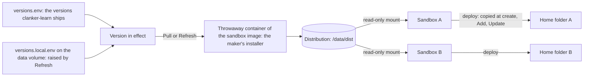
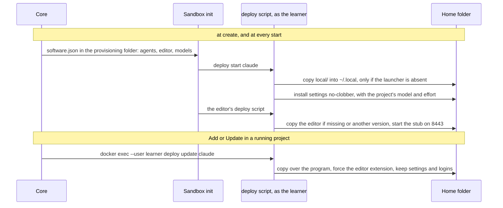

# Software

A project can be given three pieces of software: the agents Claude Code and pi, and the editor (code-server). None of them is part of the sandbox image. Each is fetched once, by its maker's installer running in a throwaway container, into a distribution on clanker-learn's data volume; every project that is given it gets its own copy in its home folder, copied from that distribution. Versions are pinned in the repository and raised from Settings. This is how research-sandbox does it, and most of the code is research-sandbox's, lifted.

Using it: [Agents and software](../guide/agents.md)

## How it works

### Fetching a distribution

| Step | What happens |
|---|---|
| The version | `versions.env` (in the image) holds the shipped pins; `/data/versions.local.env` overrides them key by key |
| The build | a container of the sandbox image on the `cl-build` network, with every capability dropped, no privilege escalation, as the sandbox user, its home a fresh staging folder; it runs the maker's installer at the pinned version and fetches the bundled extensions from Open VSX at their pins |
| The check | the result is taken only if its launcher is there, leads (through relative links only) to a program inside the tree, and that program is the version wanted; a whole tree gets a `.cl-dist` mark, written last |
| The swap | the old distribution is moved aside only once the new one is whole, and removed only after the new one is in; a failed build leaves the old one in place |
| Attempts | three, as research-sandbox |

| | Claude Code | pi | The editor |
|---|---|---|---|
| Fetched | at the first start, by itself | when you ask for it (Settings → Software) | at the first start, by itself |
| Installer | `claude.ai/install.sh` at `CLAUDE_CODE_VERSION` | research-sandbox's recipe: a private Node runtime (`NODE_VERSION`), the npm package at `PI_CODING_AGENT_VERSION`, pi-subagents, research-sandbox's rules extension and launcher | `code-server.dev/install.sh` (standalone) at `CODE_SERVER_VERSION`, with research-sandbox's list of sixteen built-in extensions removed |
| Comes with | Claude Code's editor extension (its own pin, raised together); research-sandbox's settings: bypass permissions, no attribution lines | research-sandbox's settings: every project trusted, install telemetry off; its rules extension, so pi reads the same instruction files as Claude Code | six extensions (Python and five Jupyter ones) at their own pins, research-sandbox's user and machine settings, its deploy script and lazy-start stub |
| In `/data/dist` | `agents/claude` | `agents/pi` | `editor` |
| Refresh asks | Claude Code's release feed, and Open VSX for the extension | the npm registry | code-server's latest GitHub release |

### Getting it into a project

| Button | Where | What it does |
|---|---|---|
| Pull | Settings → Software | fetches again at the version in effect, with a log |
| Refresh | Settings → Software | asks the maker for the newest version; if it is newer, offers to raise the version and pull it |
| Use repo version | Settings → Software | takes the raised version out of `versions.local.env`; then Pull |
| Add | a project's gear → Agents | copies Claude Code or pi into a running project that does not have it, and adds it to the project |
| Update | a project's gear → Agents | copies the fetched version of every agent the project has over its copy, and forces Claude Code's editor extension into the project's editor; settings and logins stay |
| Apply | a project's gear → Agents | writes Claude's model and effort, or pi's model and thinking level, into that agent's settings in the project |

A Pull never changes a running project by itself. An agent reaches a project when it is created with it, added, or updated there; a newer editor replaces the home's copy at the project's next start, never live. In a project, the Editor tab's first visit asks the stub on port 8443, which starts code-server on `127.0.0.1:8444` with no password of its own (the web server's project session is its gate) and keeps it until the container stops. Its user data lives in `/workspace/.local/share/code-server`.

In Settings → Software each row says what is fetched and the version in effect. pi's row also records its extra pins (Node, pi-subagents, the rules extension, the tree's layout); one that moved since the last pull reads "stale — re-pull".

## Design decisions

### A copy per project, not one shared program

A project's Claude Code can update itself and keeps its own login and settings; one project cannot change what another runs. The cost is disk: each copy is several hundred megabytes in the home folder, about a gigabyte for a project with Claude Code and the editor.

### Fetched by the maker's installer in a throwaway container

The installer runs with no capability, as the sandbox user, on a network the guard rules fence like a sandbox's, and can write only the new distribution. What it leaves is checked before it replaces the old one.

### Sandboxes see the distributions read-only

The whole `/data/dist` folder is mounted read-only into every sandbox: a sandbox cannot write it, as its user or as root. The folder above them all is mounted, not each distribution, because a Pull swaps a distribution by renames inside it, which a running sandbox must see.

### The copy into a home is run as the learner, never as root

The home is the learner's, and links in it must not be followed with root's rights. The deploy script is part of the sandbox image and takes a fixed argument list; it is the only command the core runs inside a sandbox (the tutor service reaches sandboxes over SSH, see [The tutor](tutor.md)).

### An agent is copied only while it is absent

At a start the deploy copies an agent only when its launcher is not in the home, so a copy that updated itself is never overwritten. Update overwrites on purpose.

### The editor is replaced at the next start

research-sandbox copies the editor into a home only when there is none, because its homes are thrown away with the container. Here a home is kept for the project's life, so the editor's deploy script also replaces the editor when a different version was fetched; that is the one change made to research-sandbox's script.

### One build at a time

A second Pull or Refresh while one runs is refused and says what is being built, rather than queued.

### Versions are never moved down by Refresh

What Refresh raises is kept in `/data/versions.local.env`, survives an upgrade of clanker-learn, and is never lowered by it; "Use repo version" is how a raised version is given up.

### Left out for now

Removing an agent from a project, and cleaning old versions out of a home folder.

## Where it lives

| Path | What |
|---|---|
| `versions.env` | The shipped versions of Claude Code, its extension, the editor and its six extensions, pi and its extra pins |
| `outer/core.py` | `SOFTWARE` (what can be fetched and how), building, checking and swapping a distribution, Refresh, the pins, Add, Update and the models |
| `outer/pi/` | research-sandbox's rules extension and settings repair for pi |
| `outer/editor/` | research-sandbox's editor deploy script, lazy-start stub and settings |
| `outer/models.json` | Claude's model tiers and the efforts each takes |
| `sandbox/deploy.sh` | Copies an agent into a home, writes its model and effort |
| `sandbox/sandbox_init.py` | Runs the deploys at every start |
