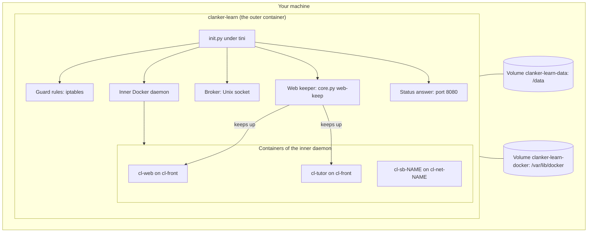
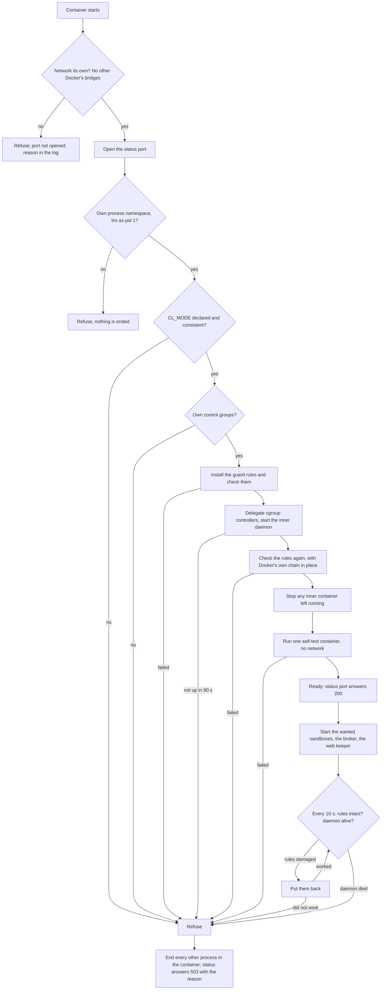
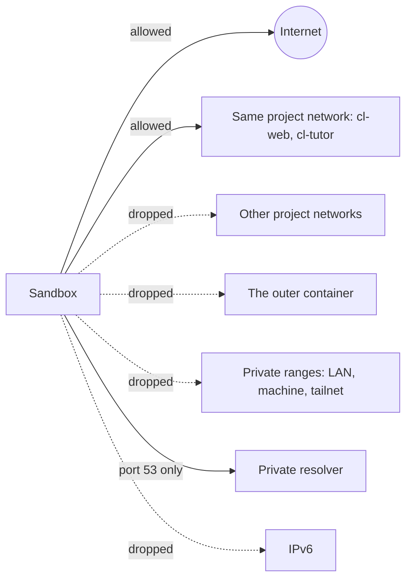

# System overview

clanker-learn is one Docker container, `clanker-learn`, started with Docker Compose. Inside it a small init (`outer/init.py`) installs firewall rules, starts a Docker daemon of its own (the inner daemon), checks that both are sound, and only then starts the rest: the broker, the projects' sandboxes, the web server and the tutor service, each sandbox and service a container of that inner daemon. Everything that is yours lives in one Docker volume, and nothing runs on your machine outside the container.

Using it: [Getting started](../guide/getting-started.md), [Configuration](../guide/configuration.md), [Troubleshooting](../guide/troubleshooting.md)

## How it works

The init is the container's main process (tini is pid 1, the init its only child). It never exits while the container runs: it watches the rules and the daemon, restarts the broker and the web keeper when they end, and writes how things stand to `/run/cl/state.json`, which the status port serves.

### The two modes

A Docker daemon inside a container needs more than a plain container gets. clanker-learn runs in one of two ways, chosen by one setting, `CL_MODE`. `./setup` writes it into `.env` the first time it runs: `sysbox` when Docker on the machine has sysbox's runtime (`sysbox-runc`), `privileged` when it has not. `compose.yaml` then takes the matching file, `modes/sysbox.yaml` or `modes/privileged.yaml`, which sets the runtime or the privilege and passes `CL_MODE` into the container.

| | sysbox mode | privileged mode |
|---|---|---|
| Set by | `CL_MODE=sysbox` (the default) | `CL_MODE=privileged` |
| Needs on the machine | Docker and sysbox | Docker |
| The container runs as | `runtime: sysbox-runc`, in a user namespace of its own | `privileged: true` |
| Root inside it is | not root on the machine | root-equivalent on the machine |
| Between a sandbox and your machine | a container boundary, the guard rules, then sysbox | a container boundary and the guard rules |
| Inner containers run on | crun | runc (Docker's default) |

The container does not guess its mode. A start with no `CL_MODE`, with a value that is neither of the two, with sysbox declared where there is no user namespace, or with neither sysbox nor privilege (no `CAP_SYS_ADMIN`), is refused with the reason.

### What happens at every start

The status port (`CL_STATUS_PORT`, 8080) answers `200` once the container is ready and `503` with the reason otherwise; `/state.json` holds the whole state. After "ready" it gains one key per part as each comes up:

| Key in `state.json` | What it says |
|---|---|
| `state`, `reason`, `mode`, `boot` | `starting`, `ready`, `refusing` or `refused`, why, the mode, and an id new at every start |
| `limits` | whether the cgroup controllers could be handed down (without them inner containers run with no limits, which is logged, not refused) |
| `sandboxes` | `starting`, then `started` or `some failed`: the projects that were running before are started again |
| `broker` | `up` once its socket accepts a connection, `down` otherwise |
| `web` | `preparing`, `up`, `off` or `down: <why>` |
| `tutor` | the tutor service, the same words |
| `sandbox_image` | the sandbox image being built, then `ready` |
| `agents`, `editor` | Claude Code's and the editor's distributions: `pulling`, then `ready: <version>` or `failed: <why>` |

The web keeper (`core.py web-keep`, a child of the init) brings the services up in a fixed order: the web server's image and container first, so the page answers as early as possible; then the tutor service; then the sandbox image; then, once each, Claude Code and the editor, fetched into their distributions (see [Software](software.md)). On a new installation that first start takes some minutes: every image is built inside the container, from the files it ships.

### Run flags it refuses

The container must have its own namespaces: otherwise its rules and its Docker would act on your machine instead of on itself. It checks this before it opens, applies or starts anything.

| Started with | What it would act on | What you see |
|---|---|---|
| `--network=host`, or another container's network where a Docker ran | the machine's network: its rules, a second Docker on the machine's bridges, a port open on every address | refused; the status port is not opened; the reason is in `docker logs` |
| `--pid=host`, `--init`, another entrypoint | the machine's processes (a refusal ends every other process it can see) | refused; nothing is ended; the status port answers 503 with the reason |
| `--cgroupns=host` | the machine's control groups | refused; the status port answers 503 with the reason |

`compose.yaml` sets none of these and sets `cgroup: private`.

### The guard rules

A sandbox runs code a tutor or a learner wrote, so it is treated as untrusted. The rules (`outer/guard.py`) sit in the outer container's own iptables, in chains of their own jumped to first from `DOCKER-USER` (traffic Docker forwards) and from `INPUT` (traffic to the outer container itself). They are keyed on the inner daemon's bridges (`docker0` and `br-*`), so they hold whatever leaves any inner network, wherever it is going.

| From a sandbox to | Allowed? | By |
|---|---|---|
| The internet | yes | |
| Another container on the same inner network (its own project's, which the web server and the tutor service join) | yes | |
| A container on another inner network, directly | no | Docker's own isolation between networks |
| Any inner container through a published port of the outer container | no | `CL-GUARD-INNER`: a new connection that was port-forwarded is dropped |
| The outer container itself (the broker's socket is not even mounted) | no | `CL-GUARD-IN` |
| Private ranges: `10/8`, `172.16/12`, `192.168/16`, `169.254/16`, `100.64/10` (your LAN, the machine, a tailnet) | no | `CL-GUARD-INNER` |
| A name resolver the outer container is configured with, when that resolver has a private address | port 53 only | `CL-GUARD-INNER` |
| Anything over IPv6 | no | `CL-GUARD6` |

### Ports

Each port is published on the same number outside the container as inside, from the same setting, because the page builds its tabs' addresses from these numbers. By default they are published on `127.0.0.1` only (`CL_BIND`).

| Setting | Default | What listens there |
|---|---|---|
| `CL_WEB_PORT` | 7788 | the page and its API (HTTPS), served by `cl-web` |
| `CL_ORIGIN_PORTS` | 11100-11164 | one port per open web-app tab (the editor and the files server among them), served by `cl-web` |
| `CL_PASSTHROUGH_PORTS` | 11200-11299 | raw TCP to ports named by hand in a project; no login in front of them |
| `CL_STATUS_PORT` | 8080 | the status answer and `state.json`, served by the init |
| `CL_BIND` | 127.0.0.1 | the address every port above is published on |

The web ports must be 1024 to 65535 and must not overlap one another or the status port. A wrong web setting leaves the container running with `web: down` and the reason; a wrong status port refuses the start.

### Inner containers and networks

| Name | What it is | Networks | Published ports |
|---|---|---|---|
| `cl-web` | the [web server](web-server.md) | `cl-front` (10.209.0.0/24), and every project's network | the page's port and both ranges |
| `cl-tutor` | the [tutor service](tutor.md) | `cl-front`, and every project's network | none |
| `cl-sb-<name>` | a project's [sandbox](sandboxes.md) | `cl-net-<name>` | none |
| `cl-build` (a network) | where the throwaway containers that fetch software run | | none |
| `cl-selftest` (an image) | one static binary, run once at every start to prove a container runs | none | none |

Project networks come from a pool of their own (10.210.0.0/16, one /24 each); the inner daemon skips a subnet that overlaps a route the outer container already has. The web server and the tutor service listen only on their `cl-front` address: a sandbox on a project network finds nothing listening there, except the tutor's tool port, which is meant for it (see [The tutor](tutor.md)).

### Where data is kept

Two named Docker volumes. The data volume is everything that is yours; the other is the inner daemon's own storage, which can be rebuilt.

| Volume (setting) | Mounted at | Holds |
|---|---|---|
| `clanker-learn-data` (`CL_DATA_VOLUME`) | `/data` | projects, homes, conversations, knowledge, the password, settings, keys, fetched software, backups |
| `clanker-learn-docker` (`CL_DOCKER_VOLUME`) | `/var/lib/docker` | the inner daemon's images and the sandboxes' containers |

| Under `/data` | What |
|---|---|
| `core/projects/<name>.json` | a project's record: limits, wanted state, agents, editor, models |
| `projects/<name>`, `homes/<name>` | a project's workspace (`/workspace` in the sandbox) and home folder (`/home/learner`) |
| `core/keys/`, `core/provision/`, `core/ports/` | a project's SSH host key and Shell password, what its sandbox is given at start, its ports named by hand |
| `core/tutor_secret` | the secret the web server and the tutor service share |
| `tutor/` | the tutor service's database (`tutor.db`), the Claude token, the keys it logs in to sandboxes with |
| `web/` | the web server's certificate, its table of tab ports, one-time download links |
| `broker/` | the password's hash and the audit log |
| `dist/`, `dist-staging/`, `versions.local.env` | the fetched software and the versions raised by Refresh |
| `backups/` | backup archives |

### Stopping

`docker compose down` (or a stop) sends SIGTERM. The init ends the broker with its operations and the web keeper, stops every inner container with a ten-second grace, stops the inner daemon, and ends whatever is left. Compose waits up to 60 seconds (`stop_grace_period`) for this. Projects that were running are started again at the next start; their sandboxes have no restart policy of their own.

## Design decisions

### One container, with its own Docker

The learner starts one thing and stops one thing. The sandboxes are plain containers of a daemon that lives inside clanker-learn, so they cannot touch the machine's Docker, and removing clanker-learn removes all of them. The cost is the nesting: the container needs sysbox or privilege, which is why the mode is the one setting that matters.

### The mode is declared, not detected, by the container

From the inside, a privileged container nested in a sysbox one looks like sysbox, so a guess could silently give the weaker boundary. The choice is made once, outside: `./setup` asks Docker which runtimes it has, writes the flag, and says which boundary it chose. Compose cannot make that check itself (a missing runtime stops `docker compose up` before any container exists), so it is a setup step and not part of every start.

### The rules go in before the daemon starts

Nothing runs before the rules are in place and checked: the init creates `DOCKER-USER` itself if the daemon has not yet, and Docker adopts it. No inner container is ever given a restart policy, and anything found running after the daemon starts is stopped, so there is no moment in which a sandbox runs unfenced.

### The rules are keyed on the inner networks, not on the uplink

They judge what leaves a sandbox's network, wherever it is going. Attaching a second network to the outer container opens nothing.

### A failure stops everything; it never continues with a warning

research-sandbox's guard warns and carries on when it cannot apply. Here a sandbox must never run without the fence, so the start is refused instead, and if the rules are damaged later and cannot be put back, everything is stopped.

### A refusal ends every other process, without asking the daemon

Containers outlive a daemon that died, so asking the daemon to stop them is not enough. The init kills every process but tini and itself, then says why. It does this only when it can tell it has a process namespace of its own; started with `--pid=host` or `--init`, it refuses without ending anything.

### Host networking is recognised by what is already there

A container with its own network starts with no Docker bridge in it. If one is listed in `/proc/net/dev`, another Docker's networks are there, and the start is refused before the status port is opened (it would open on that network). `/proc/net/dev` is read rather than `/sys/class/net`, which under sysbox lists the machine's interfaces. Limits: a machine whose Docker has no bridge goes unnoticed, and a network shared with another container is refused only once a Docker has run in it.

### Sandboxes have no IPv6

The fence is written for IPv4. The inner networks carry no IPv6, but the bridges have link-local addresses and Docker's port proxy listens on them, so a sandbox building its own IPv6 frames could reach a published port. IPv6 from every inner bridge is dropped outright.

### The private resolver exception

On a machine whose resolver is a home router or a tailnet's resolver, a sandbox could otherwise resolve no name at all. Only port 53 of that one address is opened.

### Compose, with defaults in the committed file

`compose.yaml` holds every default as `${VAR:-default}`; your machine's settings are in `.env`, which git ignores and `./setup` creates. The image is built at every `docker compose up` without a provenance record, so an unchanged build keeps its image id and leaves the running container and its sandboxes alone, while a code change is picked up by the same command.

### No ZFS tool in the image

With one present, containerd's start-up waits ten seconds on a storage probe and the nested daemon fails about half its starts. The image build fails if one appears.

### Known gaps

- In privileged mode, sandboxes get Docker's seccomp profile but not its AppArmor profile.

## Where it lives

| Path | What |
|---|---|
| `compose.yaml`, `modes/sysbox.yaml`, `modes/privileged.yaml` | The service, its defaults, its ports and volumes, and the two modes |
| `.env.example`, `setup` | The settings file `./setup` copies to `.env`, and the setup command (mode, certificates) |
| `outer/Dockerfile` | The outer image: Debian, pinned Docker and containerd, crun, the self-test binary, the files of every inner image |
| `outer/init.py` | The start sequence, the refusals, the watch, the state, the set-up code, starting the broker and the keeper |
| `outer/guard.py` | The guard rules: what they are, applying them, checking them |
| `outer/core.py` | Projects, images, the web keeper, distributions, backups; also the `cl` command |
| `versions.env` | The versions of the software projects get |
