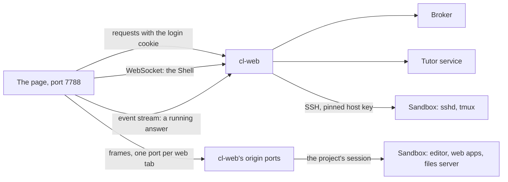

# The page

The page is what you see at `https://127.0.0.1:7788`: the login, your projects with their lessons, and for each project its conversation with the tutor, a Shell, an Editor, the web apps of its sandbox, its insights and its ports, plus Settings and Knowledge. It is one plain script with no framework and no build step, served by the [web server](web-server.md), and it does nothing by itself: every action is a request to the web server, which asks the [broker](broker.md) or the [tutor service](tutor.md).

Using it: [Projects](../guide/projects.md), [Shell, Editor and web apps](../guide/workspace.md), [Lessons](../guide/lessons.md)

## How it works

### What is on it

| Part | What it is | What it talks to |
|---|---|---|
| Login | on the first visit, the set-up code from the container's log and a new password; afterwards the password | `/broker/setup`, `/broker/login` |
| Project list | the projects with their state and, under each, its Goals conversation and lessons; `+ New project`; the gear of a project (start, stop, recreate, limits, agents, brief set, destroy); Knowledge, Settings and Log out at the bottom | the broker's `list`, polled every 4 s; the tutor's lessons |
| The open lesson's tab | the conversation with the tutor, first in the tab strip | the tutor service, through the web server |
| Shell | a terminal in the sandbox (xterm.js); it keeps its session when the tab or the browser is closed | a WebSocket to the web server, which logs in to the sandbox's sshd |
| Editor | code-server on the project's workspace, if the project has it, started at the first visit | a frame on an origin port of its own |
| One tab per web app | whatever listens in the sandbox; the tab appears a few seconds after the app starts and is marked when it is gone | a frame on an origin port of its own; the list polled every 5 s |
| Insights | what the project's tutors recorded about how you learn here | the tutor service |
| Ports | name a port by hand, as a web app or as raw TCP; raw TCP has no login in front of it, and the panel says so | the broker's port verbs |
| Settings | Interface (themes, terminal theme, editor zoom, CLI width and font size, kept by the browser), Software, Tutor (the Claude token, the default agent, the tutor's instructions), Backup, How it runs (sysbox or privileged, the certificate) | the broker, the tutor service |
| Knowledge | what clanker-learn keeps about you (see [Knowledge](knowledge.md)) | the tutor service |

In privileged mode a quiet line at the bottom of the project list says so and leads to Settings → How it runs.

### Layout

The project list is a rail that is hidden by default behind a Projects tab: it floats over the page when shown and closes on a click outside, unless it is pinned beside the page; its width changes by dragging its edge. A tab dragged to the side of the tab area opens a second column, and a third; tabs move between columns by dragging, the line between two columns changes their widths, and the layout is remembered per project. This is research-sandbox's column layout and project rail, lifted.

The browser's storage (`localStorage`) holds which project, tab, columns and lessons were last shown, the rail's state, and the interface settings: nothing else.

### What a conversation can show

What the tutor writes is data shown on the page's origin, never code run on it. Its Markdown is parsed by markdown-it into tokens, and the page builds the elements from them with text nodes; markdown-it's own HTML is never used, and raw HTML in an answer shows as the characters it is.

| The tutor writes | The page shows |
|---|---|
| a `mermaid` block | a diagram, drawn by Mermaid at its strict level without HTML labels, then copied element by element from an allow-list |
| a `vega-lite` block | an interactive plot, drawn by Vega with its expression interpreter (no code generated at run time) and a loader that refuses every address |
| ``, a `page` block | a picture or a page from the workspace, fetched from the project's files server on the project's own origin port, never from the page's origin |
| a link to a relative path | opens that file in the project's Editor, at its line |
| an exercise, a quick question, a plan proposal | a card with its own controls (see [The tutor](tutor.md) and [Knowledge](knowledge.md)) |

Mermaid and Vega are loaded the first time a conversation needs one, not with the page.

## Design decisions

### Written for clanker-learn, with two parts of research-sandbox's as they are

research-sandbox's page is built around things clanker-learn does not have, so this one was written new. Two parts are research-sandbox's as they are: the login proof and the terminal. Settings → Software, the agents' boxes, the interface settings, the column layout and the project rail were lifted and adapted to this page's helpers.

### The password never leaves the browser

The page derives a proof from it (PBKDF2, the same derivation the broker uses) and sends only that. The password and the proof live only in local variables of the call that uses them.

### A strict content-security header

The page runs its own scripts only, connects only to itself, frames and shows images only from ports of the host you opened it on, sends no form by itself, and refuses to be framed. Styles may be inline, because the terminal's renderer writes its own.

### Every web tab is a frame on its own port

An app in a sandbox is a different origin from the page and cannot act as the page. The price: a browser may want the self-signed certificate accepted once per such address; each tab has an "open in a new tab" link for that.

### No Files tab

The sandbox's files server serves single files, for what a conversation shows; the workspace is browsed in the Editor.

### It cannot sit inside another page or behind a plain-HTTP proxy

It speaks HTTPS only, refuses to be framed, and needs its ports under the same numbers the browser uses, because tab addresses are built from them.

### No phone layout yet

research-sandbox's narrow-screen layout is not built, so its Layout setting is left out of Settings → Interface.

## Where it lives

| Path | What |
|---|---|
| `web/static/index.html` | The page's shell |
| `web/static/app.js` | Everything the page does: login, projects, lessons, the conversation, tabs and columns, Settings, Knowledge |
| `web/static/style.css` | Its styles and themes |
| `web/static/vendor/` | xterm.js, markdown-it, Mermaid, Vega and Vega-Lite, committed with their licences |
| `web/server.py` | `content_security_policy`: the page's security header |
