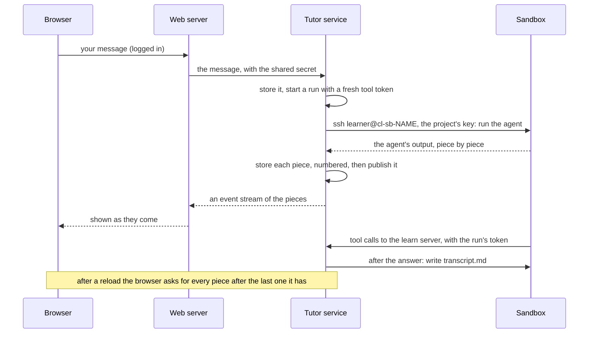
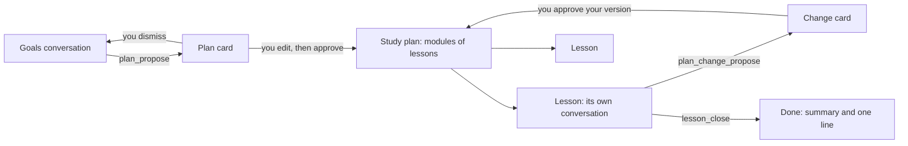
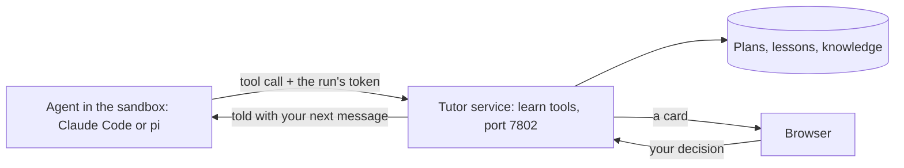

# The tutor

A lesson is a conversation with a tutor, and the tutor is one of the project's own agents, Claude Code or pi, working in the project's sandbox where you work too. The tutor service (`cl-tutor`, a container of the inner daemon) keeps the lessons, the messages and every piece of every answer in one SQLite file, starts the agent in the sandbox over SSH for each turn, and gives it a small set of tools of clanker-learn's own: read the plan, propose a change, close a lesson, set an exercise, record what it saw about how you learn. A project opens on Goals, where the tutor proposes a study plan; the plan's lessons are conversations of their own.

Using it: [Goals and the study plan](../guide/goals-and-plans.md), [Lessons](../guide/lessons.md), [Agents and software](../guide/agents.md)

## How it works

### A turn

The service starts `ssh` as a child, with the project's own key and a pinned host key, to `learner@cl-sb-<project>`, which runs the lesson's agent in `/workspace` with the tutor's instructions appended to its system prompt. No model is named: the project's own settings of that agent decide (see [Software](software.md)). Each lesson has one session per agent, made at that agent's first turn of the lesson (`--session-id`) and resumed afterwards, kept in the project's home folder; a lesson's Claude Code session shows in `claude --resume` in the Shell.

| What travels | How |
|---|---|
| Your message, the tutor's text | stdin and the command line of the agent: stream-json for Claude Code, `pi --mode rpc` for pi |
| The Claude token from Settings → Tutor, when one is set | the environment only (`CL_CLAUDE_TOKEN` over SSH, exported as `CLAUDE_CODE_OAUTH_TOKEN`): never a command line, a log, an event or the database |
| The run's id | `CL_RUN_ID` in the environment of the agent and of every command it runs, so Stop finds exactly this run's processes |
| The run's token for the tool server | `CL_RUN_TOKEN` in the environment; each agent expands it into its tool server's header. It dies with the run. |
| The answer | the agent's output stream, read into text pieces, tool calls with their results, and the context size |

The answer is stored piece by piece as it is written, each piece with a sequence number, and only then published. A browser that reloads, a second tab, or a dropped connection asks for the pieces after the last one it has and then follows live. A turn is a task of the service, not of a request: closing the browser does not stop it. One turn runs per lesson at a time; lessons run side by side, also in the same project, where their tutors then share the sandbox.

The context line under a conversation ("Context 55k of 200k tokens (92% cached)") is the size of the last request the agent made, not the totals of the turn, which add up every request.

### Stop, and what an interrupted answer looks like

Stop asks the agent to stop (an interrupt for Claude Code, `abort` for pi), waits five seconds, then ends what the run started: the processes are found as the sandbox user by `CL_RUN_ID` in their environment, with their descendants (a `sudo` child drops the tag), and killed as root. Another lesson's turn in the same sandbox is never touched, and a server the tutor started on purpose and detached survives. When the tutor service itself stops, running answers are ended the same way within a few seconds and stored as interrupted; a command that was running then reads "did not finish".

### Goals, the plan, and lessons

A plan is a list of modules, each a list of lessons with a title and an objective. A change of the plan is the whole new arrangement; a lesson it no longer names is dropped (a started one is kept, marked dropped). A lesson is not started, in progress, done or dropped; any can be opened in any order, and one added by hand stands beside the plan's. A lesson's first message carries its opening context before your text: the lesson's objective and place, the plan, one line on each lesson done, your brief, and the project's insights (see [Knowledge](knowledge.md)).

### The "learn" tools

The tutor service has a second listener, on port 7802 of every address, which is the one thing of clanker-learn's own a sandbox can reach. It speaks MCP over HTTP, and every call must carry the token of a run that is running now; the token names the project, the lesson and the run, so whose plan and records a call touches is never an argument.

| Tool | Kind | What it does |
|---|---|---|
| `plan_get`, `lesson_get`, `lesson_history` | read | the plan, this lesson (with its files' paths), one line on each lesson done |
| `brief_get`, `records_search` | read | your brief and the project's insights; a search of what this tutor may read |
| `plan_propose`, `plan_change_propose` | propose | a card in the conversation; nothing changes until you approve your version |
| `global_insight_propose` | propose | waits on the Knowledge page for you |
| `lesson_close` | write | closes the lesson with a summary and one line for later tutors |
| `insight_record`, `insight_replace`, `insight_retire` | write | how you learn in this project, resting on evidence |
| `preference_record`, `goal_record` | write | only with a sentence you typed, quoted exactly |
| `exercise_define`, `exercise_check` | write | an exercise card with a check command; running the check now |
| `quiz_ask`, `answer_grade` | write | a quick question card; grading an answer you typed |

A run may make at most 60 calls, each with a time limit (ten seconds for most) and a result of at most 64 KiB; every call is audited. An exercise's check is run by the service over its own SSH channel, not through the agent: as the sandbox user, in `/workspace`, with no credential, for at most 30 seconds. What you decide on a card, or the result of a check you pressed, is applied at once and told to the tutor with your next message.

### Two agents, one lesson

| | Claude Code | pi |
|---|---|---|
| Signs in with | the token in Settings → Tutor, else the project's own login | the project's own login to a provider, made in its Shell |
| Model | the project's model and effort | the project's model and thinking level |
| Session | `--session-id`, then `--resume` | `--session-id` in `pi --mode rpc` |
| Tool server | `--mcp-config`, only that one | an entry `learn` in pi's own `mcp.json`, written before pi starts |
| Tools, cards, knowledge | the same | the same |

A lesson's state is in files both agents can read, in the lesson's folder `/workspace/.learn/lessons/<id>-<slug>/`: `transcript.md`, the whole conversation, written by the service after every answer, and `notes.md`, kept by the tutor. An agent's own session is only a shortcut. Switch a lesson to the other agent and it starts a fresh session told to take the lesson up from those files; switch back and the first agent resumes its own session, told which turns it missed and where to read them. The same happens when a session is gone from the project, or when the tutor's instructions changed since it was made.

A lesson that has not started follows the default agent set in Settings → Tutor; one that has started stays with the agent that began it until you choose another in its header.

pi has only been run against a stand-in for a model so far; no real model has answered through it.

## Design decisions

### The tutor is the project's own agent, inside the sandbox

It runs where you work, with the project's own copy of the agent, its settings and its login, so what it installs and starts stays in the sandbox for you, and the model you gave the project is the tutor's model. research-sandbox runs its agents the same way.

### The tutor service is its own container

It holds the keys into every sandbox and the token, so it is kept apart from the web server, which faces the browser. It has no capability, no published port, and listens for its API on its `cl-front` address only; it is on every project's network only to reach the sandboxes' sshd, and a sandbox reaches only its tool port, and only with the token of an answer being written.

### It does no login of its own

It trusts the web server's check of your login and a secret only the two hold. A project is named by its name and its creation time, both filled in by the web server from the broker, so a new project with an old name starts empty.

### The instructions are passed with every answer, not a file in the project

A project's own files cannot replace them. They are one text for both agents, shipped with clanker-learn (`tutor/tutor.md`) and editable in Settings → Tutor; a lesson under way follows a new text from its next message, starting again from its files. A project's `CLAUDE.md`, if it has one, is still read, as Claude Code does.

### Only you apply a proposal

A plan, a change to it and a global insight are the tutor's suggestions. What is applied is your own edited version, and the tutor is told what you decided with your next message; it also learns what changed in the project's plan since its last turn, even from another conversation.

### Answers are stored before they are shown

Storing each piece first, with a number, is what lets a reload, a second tab or a dropped connection pick an answer up where it was, and what keeps an answer cut off by a stop honest.

### What the tutor writes is shown as text, never run

Formatting is built by the page from the tutor's words; raw HTML shows as the characters it is, and nothing the tutor names is fetched from the page's origin (see [The page](the-page.md)).

### The token can be read by code the tutor runs

The token from Settings reaches the sandbox in the agent's environment, where code the tutor runs can read it, as a project's own login can be read there. This is accepted, as research-sandbox accepts it.

### Taken from gaggiclanker

The store of answers, the stream to the browser with replay, the reading of Claude Code's output, the rule that a proposal is applied only by your action, and the wording of the context line. Not taken: sending the whole conversation again with every message.

## Where it lives

| Path | What |
|---|---|
| `tutor/server.py` | The service: its routes, the secret, the listeners on 7801 and 7802 |
| `tutor/turn.py` | A turn: SSH, the run's tags and token, Stop, the clean-up, the transcript, exercise checks |
| `tutor/agents.py` | The two agents as adapters: command lines, sessions, interrupts, outcomes |
| `tutor/claude_stream.py`, `tutor/pi_stream.py` | Reading each agent's output |
| `tutor/mcp.py`, `tutor/tools.py` | The "learn" tool server and its tools |
| `tutor/plans.py` | Plans and proposals, the opening context, what a tutor is told, the transcript |
| `tutor/cards.py` | Exercises and quick questions |
| `tutor/store.py`, `tutor/schema.sql` | The SQLite store and its versions |
| `tutor/sse.py`, `tutor/tasks.py` | The event stream with replay, background tasks |
| `tutor/tutor.md` | The tutor's instructions, as shipped |
| `tutor/Dockerfile` | The tutor service's image |
