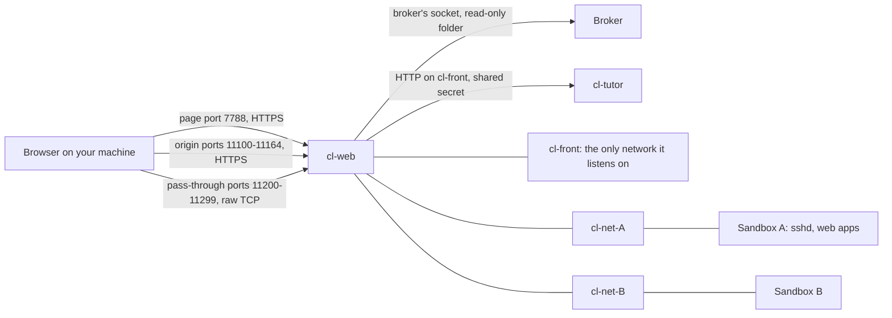
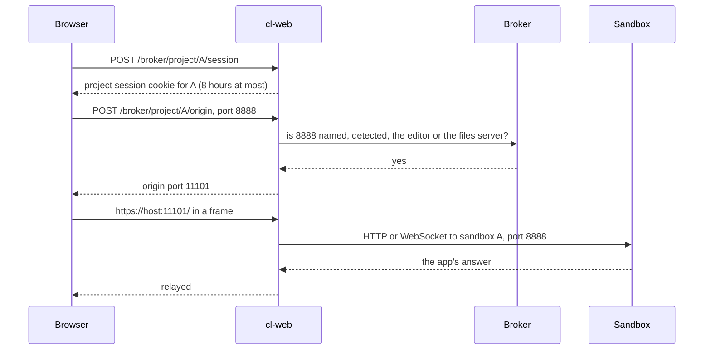

# Web server

The web server is what your browser talks to, at `https://127.0.0.1:7788` by default. It is a container of the inner Docker daemon, `cl-web`, and it holds no power of its own: no Docker socket, no project folder, no Linux capability. For anything that touches a project it asks the [broker](broker.md); for lessons and knowledge it asks the [tutor service](tutor.md); it reaches a sandbox only at the address and with the credential the broker gives it. It is research-sandbox's web server, stripped: its login, its relay to the broker and its progress routes are kept as they are.

Using it: [Shell, Editor and web apps](../guide/workspace.md), [Configuration](../guide/configuration.md)

## How it works

`cl-web` sits on a network of its own, `cl-front`, where its ports are published, and is also connected to every project's network, which is how it reaches a sandbox's sshd and web apps. It listens only on its `cl-front` address: a sandbox on a project network finds nothing listening, and the guard rules keep sandboxes from the published ports.

### What it serves

| What | Where | What stands in front of it |
|---|---|---|
| The page and its files | `/`, `/static/...` on the page's port | nothing: the login screen is part of the page |
| Logging in, the first password | `/broker/login`, `/broker/setup` | the proof (or the set-up code); failed logins are rate-limited |
| Projects, operations, Settings, backups | `/broker/...` | your login; anything that changes something must also come from the page itself (its `Origin` header) |
| Lessons, plans, knowledge | `/broker/tutor/...`, passed to the tutor service | your login and the same origin check; the web server adds the secret it shares with the tutor service |
| A terminal in the sandbox | `wss://...:7788/broker/project/<name>/terminal` | your login; the web server connects only to the sandbox the broker names, and only if it presents the project's own host key |
| A web app in the sandbox | `https://...:<a port from 11100-11164>/`, one port per app | the project's session cookie, which your login mints; another project's session does not open it |
| A port named by hand as raw TCP | `<a port from 11200-11299>` | nothing: plain TCP, published on `CL_BIND` (loopback by default) |

### Your login, held server-side

The browser sends a proof derived from the password (see [Broker](broker.md)). The web server relays it, keeps the broker's session token in its own memory, and gives the browser a random cookie instead: `HttpOnly`, `Secure`, `SameSite=Strict`, scoped to `/broker`, its name carrying the page's port. Logging out, or the broker's session ending, ends the cookie, every project session minted under it, and every terminal it opened.

### Terminals

A Shell tab is a WebSocket to the web server, which asks the broker's `attach` for the sandbox's address, user, Shell password and host-key fingerprint, then logs in over SSH with that password and runs `tmux new-session -A -s main`. The password never reaches the browser. A host key that does not match the fingerprint closes the connection; the key is never trusted on first use. Because it is one `tmux` session per project, closing the tab does not end what runs in it, and two tabs of one project show the same screen.

### Web apps on ports of their own

Each web app gets an origin port of its own from `CL_ORIGIN_PORTS`, the lowest free one, kept for that project and port across restarts (`/data/web/origin-ports.json`). A request on that port is relayed to the sandbox only when it carries a session cookie of that project; clanker-learn's own cookies are taken out of what is passed on, so an app in a sandbox never sees your login. What listens in a sandbox is found by the core reading the sandbox's listening sockets from outside it; an app the detection misses can be named by hand in the Ports tab.

### The certificate

The web server makes its own self-signed certificate (for `localhost`, `127.0.0.1` and `::1`), and makes it again when it is missing, unreadable, expired or within 30 days of expiry. The browser warns about it once per address. A self-signed certificate is not enough for the editor's previews (Markdown, notebooks): browsers refuse their service workers under a certificate they do not trust. On a machine in a Tailscale tailnet, `./setup cert-tailscale` gets a trusted certificate for the machine's tailnet name, puts it in the web server's folder with a `.custom` marker beside it, and offers to publish the page on the tailnet address; with the marker the web server never replaces the certificate, and its log and Settings → How it runs say when renewal is due (renewal is running the command again). `./setup cert-self-signed` removes the marker and goes back.

### How it comes up

The web keeper in the outer container builds the web server's image at the first start, creates `cl-front` (10.209.0.0/24, checked against the outer container's routes at every start), creates the container, connects it to every project's network, and starts it. It asks it every few seconds whether it answers; one that ended is started again, one that runs but does not answer for 30 seconds is reported `web: down` with the reason. The container is labelled with a hash of its settings and image, so a change of either makes it again.

| Setting | Default | Meaning |
|---|---|---|
| `CL_WEB` | `on` | `off` runs clanker-learn without its web server and its tutor service; projects and `cl` work all the same |
| `CL_WEB_PORT` | 7788 | the page's port |
| `CL_ORIGIN_PORTS` | 11100-11164 | the web apps' ports, one per open app |
| `CL_PASSTHROUGH_PORTS` | 11200-11299 | raw TCP ports named by hand |
| `CL_BIND` | 127.0.0.1 | the address all of them are published on |

## Design decisions

### research-sandbox's web server, stripped

Its login, its relay to the broker, its progress routes and its terminal are kept with their names and shapes; what clanker-learn does not need (research-sandbox's proof of a project's SSH password before a project session, its port probing, caching and sweeps) was taken out rather than rewritten.

### No capability, no Docker socket, no project folder

`cl-web` has the broker's socket folder (read-only), the secret it shares with the tutor service (read-only), and its own folder of the data volume (`/data/web`: the certificate, the tab ports, one-time download links). It runs with every capability dropped and no way to gain one.

### It never connects to a host the browser names

The terminal's target, a web app's address and a raw port's target are built from the project's name and the broker's answer. The browser names a project and a port, never an address.

### Every web app is a different origin

A web app is served on a port of its own, so to the browser it is a different origin from the page and cannot act as the page or read its cookies. The price is a certificate warning per address with a self-signed certificate; each tab has an "open in a new tab" link for accepting it.

### The tutor service is reached with a shared secret, not a second login

The web server checks your login once; the tutor service trusts it because each request carries a secret only the two hold (`/data/core/tutor_secret`, mounted read-only into both).

### The backups folder is never mounted here

A download links one archive into the web server's own folder after the password was given again, the web server opens it and removes the link at once, and the address works once and only for the login that asked (see [Backups](backups.md)).

## Where it lives

| Path | What |
|---|---|
| `web/server.py` | The routes, the login relay, terminals, the origin proxy, the pass-through relay, the tutor relay, the certificate |
| `web/services.py` | Cookie names, the listen address, certificate expiry |
| `web/Dockerfile` | The web server's image |
| `web/static/` | The page (see [The page](the-page.md)) |
| `outer/core.py` | `web_args`, `web_up`, `keep_web`: how the web server's container is made and kept |
| `setup` | `cert-tailscale` and `cert-self-signed` |
