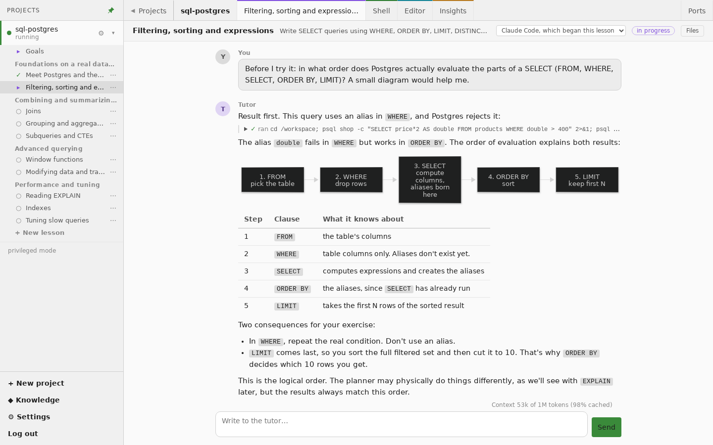

# clanker-learn

clanker-learn is a tutor you run on your own machine. You learn a technical subject by doing it, in a real Linux sandbox, with a tutor that works in that sandbox beside you and remembers what you told it about yourself. The tutor is Claude Code, on your own Claude subscription, or pi, with a provider of your choice. It runs as one Docker container that holds a sandbox for each of your projects, and keeps everything in two Docker volumes on your machine.

New here? Start with **[Getting started](guide/getting-started.md)**: install, the first start and your first password.

## A subject in six steps

1. **Make a project** for the subject: a sandbox of its own with a workspace, a terminal and a code editor, and the agent that will teach. See [Projects and sandboxes](guide/projects.md).
2. **Agree on your goals.** The project opens on Goals, a conversation in which the tutor asks what you want to be able to do, what you know and how much time you have. See [Goals and the study plan](guide/goals-and-plans.md).
3. **Approve a study plan.** The tutor proposes modules of small lessons as a card; you edit it and approve it, and the lessons appear in the list. See [Goals and the study plan](guide/goals-and-plans.md#the-plan-card).
4. **Take a lesson.** The tutor explains, builds examples in the workspace, runs commands, and shows diagrams, plots and pages; it sets exercises with a check and asks quick questions. See [Lessons](guide/lessons.md).
5. **Work beside it** in the Shell, the Editor and the tabs of the web apps you start, side by side with the conversation. See [Shell, Editor and web apps](guide/workspace.md).
6. **Keep what it knows about you.** Your goals and preferences, in your own typed words, the lessons you finished and the insights on how you learn are on the Knowledge page, where you can change, archive or undo any of it. See [The Knowledge page](guide/knowledge.md).

## Also in the guide

| Page | What it covers |
|---|---|
| [Agents and software](guide/agents.md) | Claude Code and pi, logging in, and updating them and the editor. |
| [Configuration](guide/configuration.md) | The Settings page, `./setup`, sysbox or privileged, a trusted certificate. |
| [Backups and restore](guide/backups.md) | Making backups in Settings and restoring one. |
| [Security](guide/security.md) | What a sandbox can reach, what is not protected, and how to report a problem. |
| [When it refuses to start](guide/troubleshooting.md) | Each refusal at the start, and what to do. |
| [FAQ](guide/faq.md) | Privacy, cost, which subscription, offline use, other models. |

## How it works

Curious what happens inside when you press something, or why it was built that way? The **[How it works](architecture/index.md)** section explains each part: the container, the sandboxes, the broker, the web server, the page, the tutor, the knowledge base, the software and the backups.

These docs describe what clanker-learn does today. If something here disagrees with the app, the app wins. Please [open an issue](https://github.com/joaopn/clanker-learn/issues).
